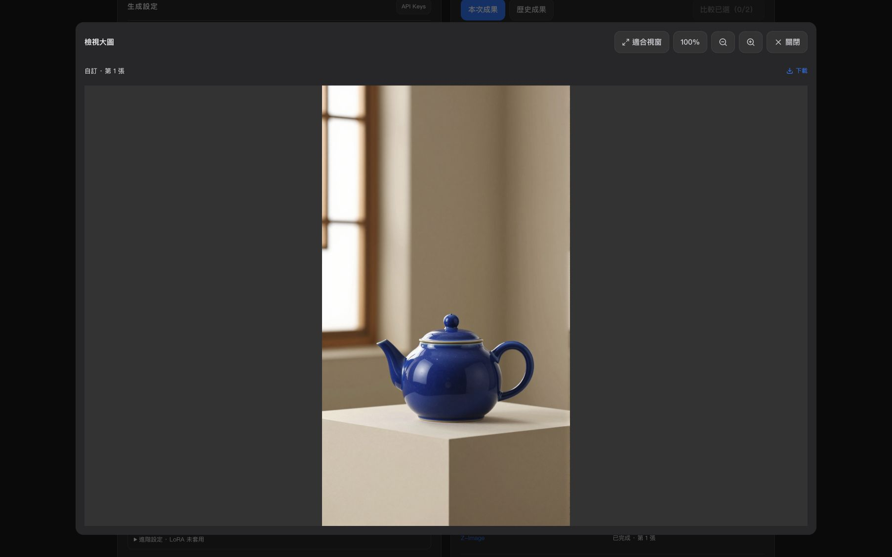

# 正式版 DLL 驗收：Comfy Cloud 生圖與舊任務取回

2026-11-07（台北時間），在 [正式版 DLL](https://cooperfu615-desinger.github.io/Virtual_Photography_Studio/) 驗證圖片任務網址修正。後端版本為 [eedbade2](https://github.com/Cooperfu615-Desinger/Virtual_Photography_Studio/commit/eedbade2ca0eb80083be8bdd4e8f24e613611881)，四個相關 Firebase Functions 已部署。新任務與舊任務都透過 DLL 的一般操作入口驗收。

| 情境 | 操作與觀察 | 結果 |
| --- | --- | --- |
| Z-Image-Turbo 新任務 | 11:29:30 在 DLL_PIC Pro 送出 1 張，9:16、1K、未套用 LoRA。畫面依序顯示「雲端排隊中」與「生成中」，隨後可開啟「檢視大圖」。 | 通過。藍色陶瓷茶壺原圖載入完成，實際尺寸為 792 × 1408。提交、查詢與回圖過程均未出現「無效的 Comfy Cloud 任務網址」。 |
| Seedream 5.0 Pro 舊任務 | 在原先顯示「無效的 Comfy Cloud 任務網址」的工作台按一次「查詢上次任務」。 | 通過。原本空白的預覽區出現第 1 張圖片、原尺寸預覽及下載按鈕。操作只查詢既有任務，未重新提交生成。 |

本次使用已授權的 Comfy Cloud 額度生成一張測試圖。未量測單筆實際扣額。圖片取回以 DLL 顯示結果驗證，本次沒有驗證下載檔案。

**新任務使用的 Prompt**

> A studio still life of a single cobalt-blue ceramic teapot on a warm ivory pedestal, soft window light from the left, no lettering.

