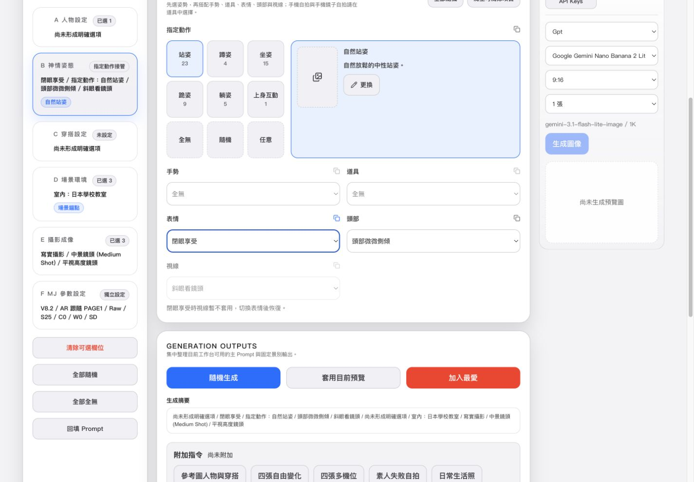
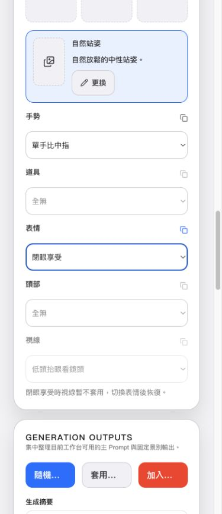

# 七項新增：接手驗證與交付

日期：2026-11-17。接手 `Prompt的新增` 的既有實作，工作目錄為 `/Users/cooperfu/Projects/Virtual_Photography_Studio`，分支 `main`，提交前 HEAD 為 `595085d5be21aa5a712ca4ec2bb29a24e7477c37`。核准來源／registry 基準仍為 `fd3f3bb14e15ec556021791bdda71b8fe8d8731f`。

**結果：七項新增與必要驗證已通過，可以依使用者授權提交並推送。** 接手期間未修改產品程式、正式分類資料、生成目錄或原有歷史基準；補充了驗收工具、紀錄與狀態說明。既有 `verification.json` 與原始 logs 保留接手前的歷史狀態，最新結論以本文、[fresh checks](rechecks.json)、[browser observations](browser/observations.json) 及 [completion evidence](completion-evidence.json) 為準。

## 交付範圍與行為

- 手勢：單手比中指、雙手比中指；沿用一般 free-hand 手勢適用範圍，不新增蹲／躺變體。
- 表情：閉眼享受、wink微笑、瞇眼微笑；保留核准眼睛及嘴型描述。
- 視線：斜眼看鏡頭、低頭抬眼看鏡頭；由現行 gaze owner 維護。
- 七項手動限定；原隨機池、順序及 RNG 呼叫保持。有效閉眼會暫停而保留視線；恢復睜眼後重新套用頭部互斥規則。手機自拍等接管仍暫停一般手勢。
- 七組輸出沿原模式契約。全身角色照仍為自然站姿、9:16，保留表情而不帶入一般手勢／視線；胸上特寫照仍為 4:5。

完整規則與來源詳見[核准規格](../../../specs/gesture-expression-gaze-additions-v1.md)及[原實作報告](../README.md)。

## 自動驗證

| 驗證 | 本次結果與證據性質 |
| --- | --- |
| 完整前端測試 | 接手前 2,371／2,371；逐一核對原 log、21 個來源的 before／after SHA256 與目前檔案。接手未改產品來源，未重跑大型完整套件 |
| Prompt Quality | 接手前 972／972；與完整前端相同的證據核對方式 |
| Lint／build | 接手前通過，既有大分包提醒保留；log 及來源已核對 |
| 聚焦手勢／表情／視線／狀態 | 本次重跑 69／69 |
| 歷史固定案例 | 本次重比 1,240 組，七輸出、selection、結構化來源及 RNG 相同，僅排除原契約的 root runtime id／date |
| Catalog read-only sync check | 本次通過：1,057 筆、保留 1,054 歷史 ID、八份生成物；未重新寫入產物 |
| Python schema／history | 本次重跑 60／60 |
| Catalog integrity／semantic／legacy | 本次重跑 33／33 |
| Strict catalog integrity | 本次 0 blocking、0 stale；既有兩個精確例外保持 |
| 精確歷史逆向 | 本次重跑 1／1；21 個 after hashes 與基準 before hashes 皆相符 |
| Strict prompt audit | 本次 count 200、seed `prompt-quality-baseline`；與原 before／after 逐位元相同，0 blocking、24 個既有 diagnostic |
| 七輸出收藏格式補充 | 本次 3／3；82 組合成記錄、246 次 JSON／Markdown／ZIP 往返，驗證全部七輸出及有效／暫存 selection、restore／regenerate |
| 預覽隔離工具 | 本次 1／1；獨立儲存前綴、記憶體狀態及 reload persistence，不接觸真實收藏 |

原大型套件證據：[inherited-evidence.json](inherited-evidence.json)。本次重跑命令、結果與 log hash：[rechecks.json](rechecks.json)。七輸出格式補充：[測試](tools/saved-seven-roundtrip.test.mjs)、[最終 log](validation-logs/saved-seven-roundtrip.log)。最初兩次補充測試因對既有 codec 的 `none` 正規化及固定動作 selection 契約假設不符而失敗；修正測試假設後通過，沒有修改產品來遷就測試，失敗紀錄保留。

暫存後的完整 whitespace 檢查指出原始 `build.log`／`lint.log`、`actual-prompts.md` 及兩份首次補充測試失敗 log 的行尾空白或結尾空行。它們是未修改的原始執行證據，保留原位元及 hash；排除這五個明確證據路徑後，其餘程式、資料、規格與驗收文件的 `git diff --cached --check` 通過。此項不作為改寫歷史證據的理由。

## 瀏覽器驗收

使用 `http://127.0.0.1:5175/Virtual_Photography_Studio/`，相同產品來源，合成狀態及獨立測試儲存。桌面 CSS viewport 1440×1000、手機 390×900；瀏覽器輸出的截圖像素尺寸另記於 completion evidence，不將兩者混用。

- 28 個案例：七選項 × 全身／中景 × 桌面／手機。每次從 Saved Cards 套用、逐一比較七組實際輸出與固定預期、核對 B 區選值，再重新整理比對七組原文。
- 六種互動：桌面閉眼暫停／恢復、低頭視線與抬頭互斥、新增七輸出收藏與詳細頁、桌面手機自拍暫停／恢復手勢；手機閉眼收藏還原／視線恢復及手機自拍手勢暫停／恢復。
- 新增收藏包含閉眼、暫存低頭視線、抬下巴與單手手勢。七分頁內容相符，套用與 reload 保留同一狀態；切回 wink 後恢復視線並清除矛盾抬頭。
- DLL_PIC Pro：桌面／手機各七種來源共 14 次帶入，原文與工作台七組輸出相符；胸上 4:5、全身角色 9:16。
- 六工作區 × 兩種 viewport，共 12 次驗收：Prompt 工作台、角色建模、場景建模、DLL_PIC Pro、DLL_VIDEO Pro、Saved Cards。
- 全部案例沒有文件橫向溢位、破圖、page error；瀏覽器 console warn／error 為空。選中、停用及恢復狀態均已實際操作。沒有提交任何付費生成。

完整紀錄：[observations.json](browser/observations.json)。代表截圖：

測試分頁已關閉，暫時 viewport 已重置，這次自行啟動的 5175 預覽已關閉。這次以經授權的 HTTP 預覽完成驗收，沒有修改全域權限，也沒有繞過 `file://` 限制。

## 提交與保護

使用者已授權本批 commit／push 到 `main`。提交只納入七項新增相關程式、資料、測試與證據；使用 `[skip ci]` 保持本次提交／推送範圍，不觸發儲存庫的自動 Pages 部署。遠端 SHA 於提交推送後另行讀回確認。

`Docs/current_project_state.md`、`Docs/session_onboarding.md` 的既有修改、另一 session 的室內坐姿提交，以及原有研究資料、圖片、腳本與 `generated_images/` 保留並排除 staging。接手前的來源與無關檔案均以逐檔 SHA256 核對；只有本文新增的工具／證據與原規格／報告的接手狀態說明有所追加。

## 剩餘限制

本次確認應用行為、文字契約、資料相容與介面；未在 Speed／Quality 或其他付費外部模型逐組出圖，因此不保證模型對手指、眼睛或頭眼關係的實際還原率。沒有部署、登入真實帳號或讀寫私人收藏。既有大分包提醒及 24 個 audit diagnostic 未在本批處理。
