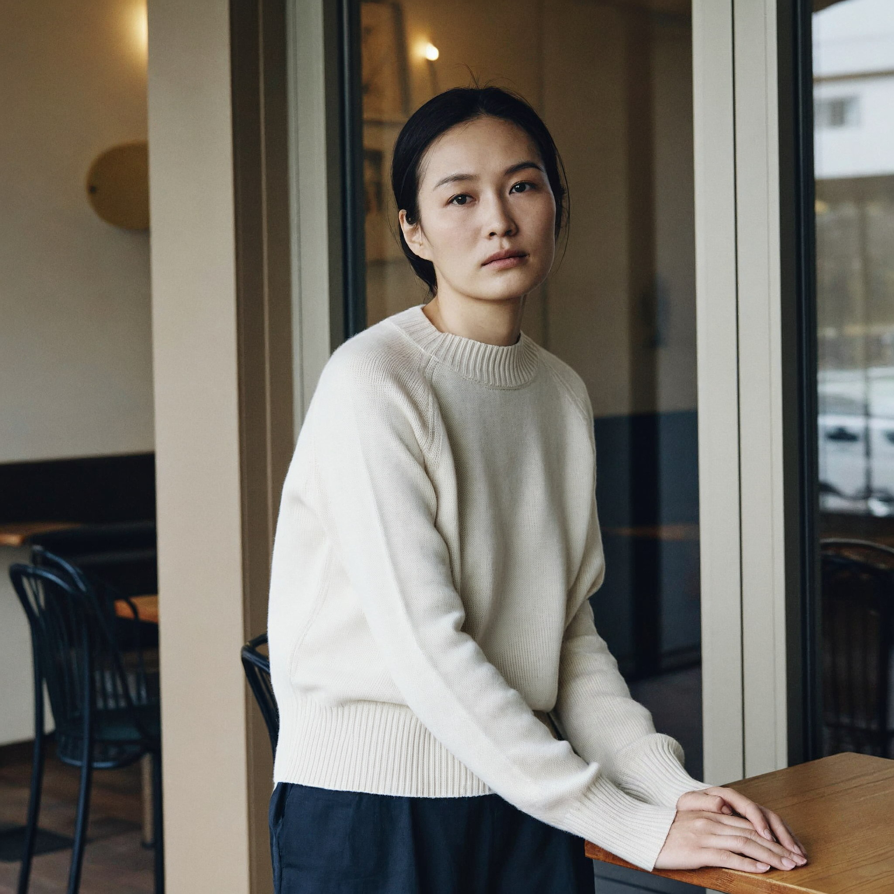

# MiniMax H3 Image 4 MP Cloud API 驗收

日期：2026-11-14，Asia/Taipei。使用者明確授權一張 Comfy Cloud 額度測試。此為獨立 API 工作流，不修改 DLL、不部署、不提交 Git，也未另存 Cloud 網頁命名草稿。

## 已確認可用

- 主模型：`minimax_h3_image_pruned_int8_convrot.safetensors`，20,979,314,802 bytes。
- 文字編碼器：`qwen3vl_32b_minimax_h3_nvfp4_awq.safetensors`；Cloud CLIPLoader enum 可見，且本次實際使用成功。另有 INT8 convrot 版本列於 enum，但本次未測該版本。
- VAE：`minimax_h3_image_vae_fp16.safetensors`，1,168,505,312 bytes。
- 主模型與 VAE 沒有出現在本次 object_info loader enum，卻存在於 Cloud 公開資產庫。使用其正式 loader_path 提交成功，因此不可僅憑 enum 缺項推定不可用。
- 所需 12 節點均在 object_info 可查，包含 MiniMaxH3ImageConditioning、SamplerLCM、SamplerCustomAdvanced 與一般載入／解碼／輸出節點。node-info.json 保留當次定義；model-assets.json 保留最小資產證據。

## 工作流

- 基於 vyrekai 工作流 revision `e4cd9d99b339fd15b714ac31228498e4625f0ae4` 的核心採樣連線，移除參考圖、擴寫、介面開關與尺寸選擇器，建立 12 節點 API JSON。
- 2048 × 2048（4,194,304 pixels，約 4 MP）、一張、Seed 20261114。
- 6 steps、CFG 1、simple、denoise 1；SamplerLCM s_noise 1.1、s_noise_end 0.9、noise_clip_std 0。
- 無參考圖、無擴寫。Prompt 全文在 workflow-api.json，內容為完整著衣的 30 歲成年女性咖啡廳窗邊肖像。
- 節點必填輸入已對照即時 schema；本次 paid execution 也證實執行可行。

## API、耗時與下載

- 只 POST `/api/v2/jobs` 一次，沒有重試付費提交。
- job ID：`29fbe056-98ae-4d75-ab56-29a30ab50e6b`。
- 狀態依序 queued → running → succeeded；使用固定 HTTPS jobs 端點查詢。
- Cloud metrics：queue_ms 1985，execution_ms 10867。
- 開始準備／查餘額時間 10:12:44.681 UTC，觀察到成功 10:13:04.287 UTC，約 19.6 秒，包含前置餘額查詢與輪詢間隔；不能當成純推論耗時。
- 完成圖片下載與後置餘額查詢為 10:13:08.832 UTC，總流程約 24.2 秒。
- 由 `/api/v2/assets/{id}` 取得 HTTPS 下載網址，下載時不附帶 API 金鑰。
- PNG 5,409,883 bytes，檔頭與 IHDR 驗證 2048 × 2048；SHA-256 記錄於 acceptance.json。沒有保存金鑰或限時圖片 URL。

## 帳務

- 測試前：324.420776734 cents，約 684.527838909 Credits。
- 測試後：323.1166015295 cents，約 681.776029227 Credits。
- 差額：US$0.013041752045，依 DLL 211 Credits/USD 換算約 **2.751809681 Credits**。
- 以上為本次帳務查詢窗口餘額差，不是單筆發票；本腳本只提交一張，但無法排除帳號其他裝置同期使用，不能當成固定每張報價。

## 圖像效果與後續界線

實際檢視 result.png：臉部、眼睛、皮膚及毛衣針織紋理可辨，窗邊光線自然，兩手位於木桌上，未見明顯大面積破圖。實際構圖包含髖部附近，比 Prompt 要求的腰上肖像更寬；手部細節與精確構圖仍應由使用者判斷。單張不代表身份一致性、所有比例或 16 MP 品質均通過。

這次證實 Cloud API 接入可行；DLL 模型選項、尺寸映射、逐張生成、歷史與額度 UI 尚未整合或驗收。16 MP、多圖參考及擴寫均未測。

## 證據

- [API 工作流](workflow-api.json)
- [任務／帳務／下載紀錄](acceptance.json)
- [生成原圖](result.png)
- [作者工作流](https://huggingface.co/vyrekai/minimax-h3-image-comfyui-workflows)

